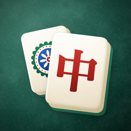

# Mahjong Four Ways: Support

**Mahjong Four Ways** is a free iPhone game with four rulesets: Hong Kong, Japanese Riichi, Chinese Official (MCR) and American. No ads, no purchases, no sign-in.

## Get help

Found a bug or have a question? [Open an issue](https://github.com/ChrisMahlke/mahjong-support/issues/new) with your iPhone model, iOS version and what happened.

## Privacy policy

*Last updated: October 2026*

Mahjong Four Ways does not collect any personal data. The developer does not receive, store or share any information about you.

- **On your device:** progress, saved games, settings and lesson history are stored only on your device and in its backups. Deleting the app deletes them.
- **Playing with others:** the app sends only what a game needs directly to the other players at your table: your player name, a game identifier, your moves and the stickers or set phrases you choose. Online games use Apple's Game Center; nearby games connect devices directly over Wi-Fi or Bluetooth. Nothing typed is ever sent.
- **Game Center:** if signed in, your nickname and photo are read from Game Center under [Apple's privacy policy](https://www.apple.com/legal/privacy/).
- **No tracking:** no advertising, no analytics and no third-party tracking.
- **Children:** suitable for all ages and collects no data from anyone.

If this policy changes, the new version will be posted here. Contact: open an issue on this repository.

© 2026 Chris Mahlke
